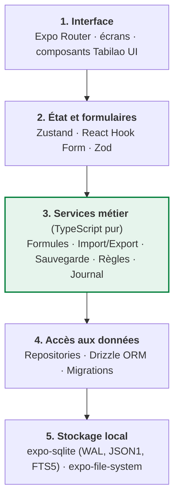
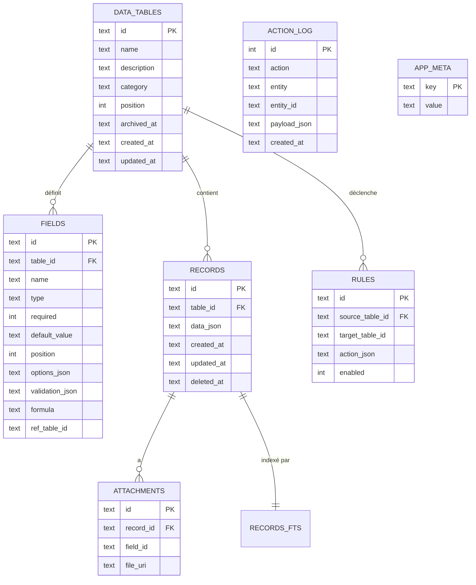
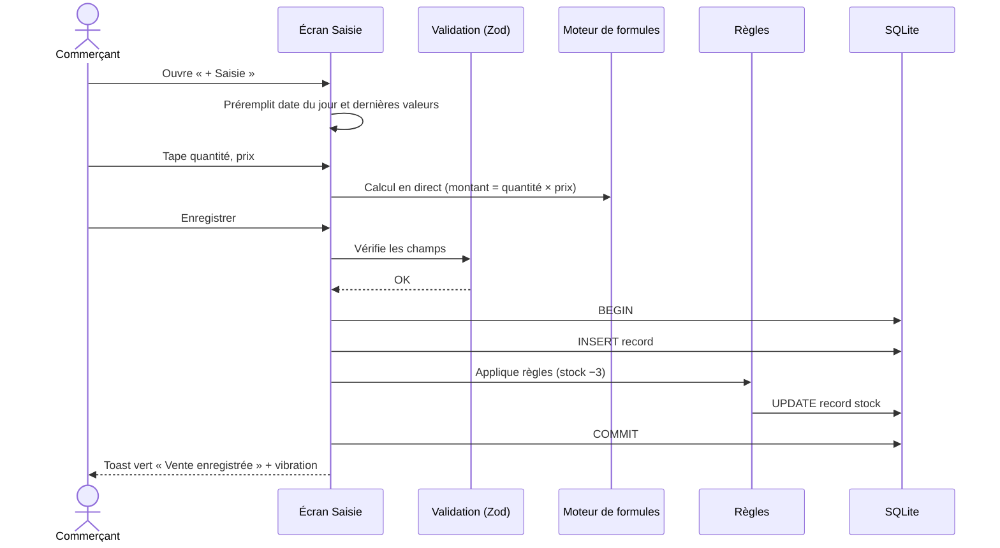
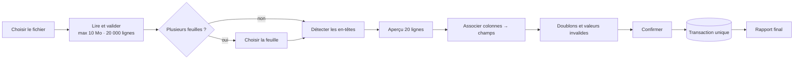
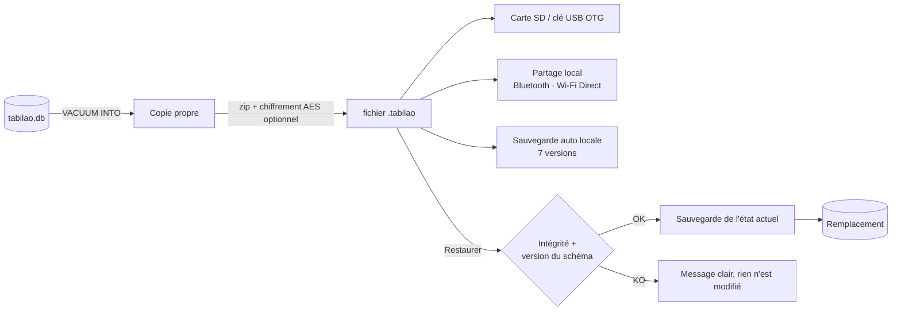

# Tabilao Mobile — Architecture et Design System

> **Vos données, simplement.**
> Application Android 100 % hors ligne · React Native + Expo + TypeScript · SQLite
> Version du document : 1.0 — 23 octobre 2026

---

## Sommaire

1. [Principes d'architecture](#1-principes-darchitecture)
2. [Vue d'ensemble en couches](#2-vue-densemble-en-couches)
3. [Structure du projet](#3-structure-du-projet)
4. [Modèle de données SQLite](#4-modèle-de-données-sqlite)
5. [Flux principaux](#5-flux-principaux)
6. [Moteur de formules](#6-moteur-de-formules)
7. [Garantie 100 % hors ligne](#7-garantie-100--hors-ligne)
8. [Sécurité et fiabilité](#8-sécurité-et-fiabilité)
9. [Design System — couleurs du drapeau malgache](#9-design-system--couleurs-du-drapeau-malgache)
10. [Typographie, espacements, formes](#10-typographie-espacements-formes)
11. [Composants d'interface](#11-composants-dinterface)
12. [Écrans clés](#12-écrans-clés)
13. [Tokens en code (theme.ts)](#13-tokens-en-code-themets)
14. [Conventions de développement](#14-conventions-de-développement)

---

## 1. Principes d'architecture

| Principe | Conséquence concrète |
|---|---|
| **100 % hors ligne** | Aucun appel réseau dans le code de l'application. Tout est embarqué dans l'APK. |
| **Le téléphone est la source de vérité** | SQLite est l'unique base. Pas de serveur, pas de compte. |
| **Logique métier indépendante de l'UI** | Les services (calculs, import, sauvegarde) sont en TypeScript pur, testables sans écran. |
| **Tableaux dynamiques** | Les champs sont des données, pas du code : ajouter un champ ne demande aucune migration. |
| **Tout ou rien** | Import, restauration, règles entre tableaux : une seule transaction SQLite. |
| **Appareils modestes d'abord** | Conçu et testé pour un Android 8+ avec 2 Go de RAM. |

---

## 2. Vue d'ensemble en couches



**Règle d'or :** une couche n'appelle que celle du dessous. Un écran n'écrit jamais directement en SQL ; il passe par un hook, qui appelle un service, qui appelle un repository.

### Pile technique

| Besoin | Bibliothèque | Remarque hors ligne |
|---|---|---|
| Framework | Expo (build de développement + EAS Build) | `expo-updates` désactivé |
| Navigation | Expo Router | — |
| Base de données | `expo-sqlite` | Mode WAL, JSON1, FTS5 |
| ORM / migrations | Drizzle ORM | Migrations embarquées dans l'APK |
| État global | Zustand | — |
| Formulaires | React Hook Form + Zod | Schéma Zod généré depuis les champs |
| Listes longues | `@shopify/flash-list` | 50 000 lignes fluides |
| Excel | SheetJS (`xlsx`) | Lecture/écriture locale |
| CSV | PapaParse | Détection du séparateur |
| Fichiers | `expo-document-picker`, `expo-file-system`, `expo-sharing` | — |
| Sécurité | `expo-local-authentication`, `expo-crypto` | PIN, biométrie, chiffrement |
| Langues | i18next | Français, malgache, anglais embarqués |
| Polices | `expo-font` | Fichiers `.ttf` dans `assets/` |
| OCR (v2) | ML Kit Text Recognition, **modèle intégré** | Pas de téléchargement à l'usage |
| Voix (v2, option) | Vosk + petit modèle français | Module optionnel (~40 Mo) |

---

## 3. Structure du projet

```text
tabilao/
├── app/                          # Écrans (Expo Router)
│   ├── _layout.tsx               # Thème, i18n, ouverture DB, verrou PIN
│   ├── index.tsx                 # Accueil
│   ├── onboarding.tsx            # Premier démarrage (3 choix)
│   ├── tables/
│   │   ├── index.tsx             # Liste des tableaux
│   │   ├── new.tsx               # Créer / depuis modèle
│   │   └── [tableId]/
│   │       ├── index.tsx         # Consultation + filtres
│   │       ├── entry.tsx         # Saisie rapide
│   │       ├── edit.tsx          # Éditeur de champs
│   │       └── record/[recordId].tsx
│   ├── import/                   # Assistant d'import (étapes 1 à 10)
│   ├── backup.tsx
│   └── settings.tsx
│
├── src/
│   ├── ui/                       # Design system Tabilao UI
│   │   ├── theme.ts              # Tokens (couleurs, typo, espaces)
│   │   ├── components/           # Button, Card, Field, Chip, Fab, Toast…
│   │   └── icons/
│   ├── features/                 # Logique d'écran par domaine
│   │   ├── tables/  (hooks + stores)
│   │   ├── entry/
│   │   ├── search/
│   │   └── import/
│   ├── services/                 # Couche métier pure (sans React)
│   │   ├── formula/              # tokenizer.ts, parser.ts, evaluate.ts
│   │   ├── validation/           # buildZodSchema(fields)
│   │   ├── import/               # xlsxReader.ts, csvReader.ts, mapper.ts, dedupe.ts
│   │   ├── export/               # xlsxWriter.ts, csvWriter.ts
│   │   ├── backup/               # backup.ts, restore.ts, integrity.ts
│   │   ├── rules/                # Règles entre tableaux (vente → stock)
│   │   └── money.ts              # Montants en entiers (ariary)
│   ├── data/
│   │   ├── db.ts                 # Ouverture SQLite, PRAGMA
│   │   ├── schema.ts             # Schéma Drizzle
│   │   ├── migrations/           # 0001_init.sql, 0002_…
│   │   └── repositories/         # tablesRepo, fieldsRepo, recordsRepo, logRepo
│   ├── templates/                # Modèles A (ventes), B (dépenses), C (stock), D (crédits)
│   └── i18n/                     # fr.json, mg.json, en.json
│
├── assets/                       # Polices, icônes, logo, images onboarding
├── tests/                        # Jest (services) + Maestro (bout en bout)
└── app.config.ts                 # Permissions minimales, updates désactivées
```

---

## 4. Modèle de données SQLite



### Choix clés

- **`records.data_json`** stocke `{ "<field_id>": valeur }`. Ajouter, renommer ou réordonner un champ ne touche pas au schéma.
- **Montants** : entiers en ariary (`INTEGER`). Pas de `REAL` pour l'argent.
- **Dates** : texte ISO 8601 (`2026-10-23`), triable et filtrable.
- **Identifiants** : UUID v4, prêts pour une éventuelle synchronisation future.
- **Suppression logique** : `deleted_at` + corbeille de 30 jours.
- **Champs `ref_table_id` et table `rules`** : créés dès le MVP pour accueillir le lien ventes → stock sans migration lourde.

### Initialisation

```sql
PRAGMA journal_mode = WAL;
PRAGMA foreign_keys = ON;
PRAGMA synchronous = NORMAL;

CREATE INDEX idx_records_table ON records(table_id, deleted_at, created_at);
CREATE VIRTUAL TABLE records_fts USING fts5(record_id UNINDEXED, content);
```

---

## 5. Flux principaux

### 5.1 Saisie rapide



### 5.2 Import Excel / CSV



### 5.3 Sauvegarde et restauration



---

## 6. Moteur de formules

Aucun `eval()`. Un analyseur maison en trois étapes :

1. **Tokenizer** : nombres, références `{Quantité}`, opérateurs, parenthèses, fonctions.
2. **Parser** : construit un arbre syntaxique ; refuse tout ce qui n'est pas autorisé.
3. **Évaluateur** : parcourt l'arbre avec les valeurs de la ligne.

| Autorisé | Exemple |
|---|---|
| `+ - * / %` | `{Quantité} * {Prix unitaire}` |
| `SOMME, MOYENNE, MIN, MAX` | `SOMME({Montant})` (sur la colonne) |
| `SI(condition; oui; non)` | `SI({Stock} < {Seuil}; "Alerte"; "OK")` |
| Parenthèses | `({Prix} - {Remise}) * {Quantité}` |

Protections : division par zéro → erreur affichée sous le champ ; références circulaires refusées à l'enregistrement du champ ; profondeur d'arbre limitée à 32.

---

## 7. Garantie 100 % hors ligne

| Point | Décision |
|---|---|
| Mises à jour à distance | `expo-updates` désactivé (`updates.enabled: false`) |
| Permission Internet | Retirée du manifeste Android si aucun module ne l'exige |
| Polices, icônes, traductions | Embarquées dans `assets/` et `src/i18n/` |
| Suivi des plantages | Aucun service en ligne ; journal local exportable par l'utilisateur |
| OCR | Modèle ML Kit **intégré** à l'APK |
| Voix | Moteur Vosk embarqué (module optionnel) |
| Distribution | Google Play **et** APK partageable (SD, USB, Bluetooth) |
| Partage WhatsApp / SMS | Tabilao prépare le contenu ; l'envoi dépend du réseau de l'opérateur |
| Test de recette | Toute la suite Maestro tourne en **mode avion** |

---

## 8. Sécurité et fiabilité

- **Verrouillage** : PIN à 4–6 chiffres ou empreinte, optionnel.
- **Sauvegardes chiffrées** : AES-256 avec clé dérivée du mot de passe de sauvegarde.
- **Intégrité** : `PRAGMA integrity_check` au démarrage après une restauration.
- **Transactions** : import, restauration, règles et migrations sont atomiques.
- **Journal local** : `action_log` permet de tracer et d'annuler la dernière action.
- **Confidentialité** : aucune donnée ne quitte le téléphone sans un geste explicite de l'utilisateur.

---

## 9. Design System — couleurs du drapeau malgache

Le drapeau de Madagascar associe **le blanc** (pureté), **le rouge** (souveraineté) et **le vert** (espoir, nature, prospérité). Tabilao les transpose ainsi :

| Couleur du drapeau | Rôle dans Tabilao | Pourquoi |
|---|---|---|
| **Vert** | Couleur principale : boutons, actions, recettes, succès | L'espoir et la prospérité, l'argent qui rentre |
| **Blanc** | Fond, cartes, espace de respiration | Clarté et simplicité, cœur de la promesse |
| **Rouge** | Accent : alertes, dépenses, suppression, stock bas | La vigilance ; utilisé avec parcimonie |

### 9.1 Palette principale

| Token | Hex | Usage | Contraste sur blanc |
|---|---|---|---|
| `green-600` **Vert Tabilao** | `#007E3A` | Bouton principal, FAB, liens, en-têtes actifs | 5,2:1 ✅ AA |
| `green-700` | `#00652F` | État pressé | 7,2:1 ✅ AAA |
| `green-500` | `#2E9A5C` | Icônes, graphiques | 3,6:1 (grands éléments) |
| `green-100` | `#D9F0E3` | Puces sélectionnées, badges « Payé » | — |
| `green-50` | `#EEF8F2` | Fond des sections mises en avant | — |
| `red-500` **Rouge drapeau** | `#FC3D32` | Pastilles, icônes d'alerte, bande décorative | 3,7:1 (grands éléments seulement) |
| `red-600` **Rouge texte** | `#D62B21` | Textes et boutons rouges (supprimer, dépense) | 5,0:1 ✅ AA |
| `red-100` | `#FDE2E0` | Fond d'alerte, stock bas | — |
| `white` | `#FFFFFF` | Cartes, fond des formulaires | — |

> Le rouge vif du drapeau (`#FC3D32`) n'atteint pas le contraste AA pour du petit texte blanc. Pour les textes et boutons, on utilise sa variante `#D62B21`.

### 9.2 Neutres (gris légèrement verdis)

| Token | Hex | Usage |
|---|---|---|
| `ink-900` | `#14201A` | Texte principal |
| `ink-600` | `#4A5A52` | Texte secondaire, libellés |
| `ink-400` | `#8A9890` | Placeholders, icônes inactives |
| `line` | `#E3E9E5` | Bordures, séparateurs |
| `surface` | `#F6F8F7` | Fond de l'application (derrière les cartes blanches) |

### 9.3 Couleurs sémantiques

| Sens | Couleur | Exemple |
|---|---|---|
| Succès / recette | `green-600` | « Vente enregistrée », montants entrants |
| Danger / dépense | `red-600` | « Supprimer », montants sortants |
| Avertissement | `#B7791F` (ambre) | « Aucune sauvegarde depuis 7 jours » |
| Information | `ink-600` | Aides et explications |

### 9.4 Mode sombre

| Token | Clair | Sombre |
|---|---|---|
| Fond | `#F6F8F7` | `#0F1613` |
| Carte | `#FFFFFF` | `#18221D` |
| Texte | `#14201A` | `#ECF2EE` |
| Vert principal | `#007E3A` | `#3DBE74` |
| Rouge | `#D62B21` | `#FF6B61` |
| Bordure | `#E3E9E5` | `#2A3630` |

### 9.5 Signature visuelle

Une fine **bande tricolore** (blanc · rouge · vert, 4 px) sur l'écran d'accueil et l'écran de démarrage, en clin d'œil discret au drapeau, sans le reproduire. Le logo : un « T » formé de trois cellules de tableau, la première blanche, la deuxième rouge, la troisième verte.

```text
┌──────────────────────────────┐
│ ▌blanc ▌ rouge ▌ vert         │  ← bande signature (4 px)
│                              │
│   ┌───┐                      │
│   │ T │  Tabilao             │
│   └───┘  Vos données,        │
│          simplement.         │
└──────────────────────────────┘
```

---

## 10. Typographie, espacements, formes

### Typographie

Police : **Inter** (embarquée, lisible, chiffres tabulaires pour les montants).

| Style | Taille / interligne | Graisse | Usage |
|---|---|---|---|
| `display` | 28 / 34 | 700 | Total du jour sur l'accueil |
| `title` | 22 / 28 | 600 | Titre d'écran |
| `heading` | 18 / 24 | 600 | Titre de carte, de section |
| `body` | 16 / 24 | 400 | Texte courant, champs |
| `label` | 14 / 20 | 500 | Libellés de champs |
| `caption` | 12 / 16 | 400 | Dates, aides |
| `amount` | 18 / 24 | 600, chiffres tabulaires | Montants dans les listes |

Les montants s'affichent avec un séparateur d'espace : `12 500 Ar`.

### Espacements (base 4)

`4 · 8 · 12 · 16 · 24 · 32 · 48` — marge d'écran : 16 ; espace entre cartes : 12 ; entre champs : 16.

### Formes et élévation

| Élément | Rayon | Ombre |
|---|---|---|
| Boutons, champs | 12 | aucune |
| Cartes | 16 | très légère (`0 1 2 rgba(0,0,0,0.06)`) |
| Bouton flottant (FAB) | 28 (rond) | moyenne |
| Puces (chips) | 999 | aucune |

### Ergonomie

- Cibles tactiles **≥ 48 dp**.
- Actions principales en **bas d'écran**, à portée du pouce.
- Clavier numérique automatique sur les champs Nombre.
- Respect de la taille de police choisie dans Android.

---

## 11. Composants d'interface

| Composant | Description | Couleurs |
|---|---|---|
| **Bouton principal** | Pleine largeur, 52 dp de haut | Fond `green-600`, texte blanc |
| **Bouton secondaire** | Contour 1,5 dp | Bordure et texte `green-600` |
| **Bouton danger** | Pour supprimer, toujours après confirmation | Texte `red-600`, fond `red-100` au toucher |
| **FAB « + Saisie »** | Toujours visible en bas à droite | `green-600`, icône blanche |
| **Carte de tableau** | Nom, nombre de lignes, total du jour, icône de catégorie | Fond blanc, bordure `line` |
| **Champ de saisie** | Libellé au-dessus, aide en dessous, erreur en rouge | Focus : bordure `green-600` 2 dp |
| **Champ calculé** | Fond `green-50`, icône « = », non éditable | Valeur en `green-700` |
| **Puce de filtre** | Sélection rapide (Aujourd'hui, Semaine, Mois) | Active : `green-100` + texte `green-700` |
| **Toast** | Confirmation 2 s en bas | Succès vert, erreur rouge |
| **Badge stock bas** | Sur la carte produit | Fond `red-100`, texte `red-600` |
| **Montant** | Entrées en vert avec « + », sorties en rouge avec « − » | `green-600` / `red-600` |

---

## 12. Écrans clés

### Accueil

```text
┌──────────────────────────────┐
│ ▌▌▌  Tabilao           ⚙     │
│                              │
│  Aujourd'hui                 │
│  ┌────────────────────────┐  │
│  │ Recettes   + 245 000 Ar│  │  ← vert
│  │ Dépenses   −  38 500 Ar│  │  ← rouge
│  │ Solde        206 500 Ar│  │
│  └────────────────────────┘  │
│                              │
│  Mes tableaux                │
│  ┌──────────┐ ┌──────────┐   │
│  │ 🛒 Ventes │ │ 💸 Dépen.│   │
│  │ 42 lignes│ │ 18 lignes│   │
│  └──────────┘ └──────────┘   │
│  ┌──────────┐                │
│  │ 📦 Stock  │ ● 3 bas        │  ← badge rouge
│  └──────────┘                │
│  ⚠ Dernière sauvegarde : 8 j │  ← ambre
│                      ┌─────┐ │
│                      │ + ✎ │ │  ← FAB vert
└──────────────────────┴─────┴─┘
```

### Saisie rapide

```text
┌──────────────────────────────┐
│ ←  Nouvelle vente            │
│                              │
│  Date                        │
│  [ 23/10/2026            📅 ]│
│  Produit                     │
│  [ Savon Nosy        ▾     ] │  ← autocomplétion
│  Quantité        Prix unit.  │
│  [ 3      ]      [ 1 500  ]  │
│  ┌────────────────────────┐  │
│  │ = Montant     4 500 Ar │  │  ← champ calculé vert pâle
│  └────────────────────────┘  │
│  Paiement                    │
│  (Espèces) (MVola) (Crédit)  │  ← puces
│                              │
│  [   Enregistrer et suivant ]│  ← secondaire
│  [█████ Enregistrer ███████] │  ← principal vert
└──────────────────────────────┘
```

### Parcours en 3 gestes

1. **Toucher** le bouton « + Saisie ».
2. **Remplir** 2 ou 3 champs (le reste est prérempli ou calculé).
3. **Enregistrer** → toast vert « Vente enregistrée ».

---

## 13. Tokens en code (`theme.ts`)

```ts
// src/ui/theme.ts
export const palette = {
  green50: '#EEF8F2',
  green100: '#D9F0E3',
  green500: '#2E9A5C',
  green600: '#007E3A', // Vert Tabilao (drapeau)
  green700: '#00652F',
  red100: '#FDE2E0',
  red500: '#FC3D32',   // Rouge drapeau (décor, pastilles)
  red600: '#D62B21',   // Rouge lisible (textes, boutons)
  amber600: '#B7791F',
  white: '#FFFFFF',
  ink900: '#14201A',
  ink600: '#4A5A52',
  ink400: '#8A9890',
  line: '#E3E9E5',
  surface: '#F6F8F7',
} as const;

export const lightTheme = {
  background: palette.surface,
  card: palette.white,
  text: palette.ink900,
  textMuted: palette.ink600,
  border: palette.line,
  primary: palette.green600,
  primaryPressed: palette.green700,
  primarySoft: palette.green100,
  danger: palette.red600,
  dangerSoft: palette.red100,
  accent: palette.red500,
  warning: palette.amber600,
  income: palette.green600,
  expense: palette.red600,
};

export const darkTheme: typeof lightTheme = {
  background: '#0F1613',
  card: '#18221D',
  text: '#ECF2EE',
  textMuted: '#A9B8B0',
  border: '#2A3630',
  primary: '#3DBE74',
  primaryPressed: '#2E9A5C',
  primarySoft: '#173A27',
  danger: '#FF6B61',
  dangerSoft: '#3A1A18',
  accent: '#FF6B61',
  warning: '#E0A84A',
  income: '#3DBE74',
  expense: '#FF6B61',
};

export const spacing = { xs: 4, sm: 8, md: 12, lg: 16, xl: 24, xxl: 32, xxxl: 48 } as const;
export const radius = { field: 12, card: 16, fab: 28, pill: 999 } as const;

export const typography = {
  display: { fontFamily: 'Inter-Bold', fontSize: 28, lineHeight: 34 },
  title: { fontFamily: 'Inter-SemiBold', fontSize: 22, lineHeight: 28 },
  heading: { fontFamily: 'Inter-SemiBold', fontSize: 18, lineHeight: 24 },
  body: { fontFamily: 'Inter-Regular', fontSize: 16, lineHeight: 24 },
  label: { fontFamily: 'Inter-Medium', fontSize: 14, lineHeight: 20 },
  caption: { fontFamily: 'Inter-Regular', fontSize: 12, lineHeight: 16 },
  amount: { fontFamily: 'Inter-SemiBold', fontSize: 18, lineHeight: 24, fontVariant: ['tabular-nums'] },
} as const;

export const formatAriary = (value: number): string =>
  `${value.toLocaleString('fr-FR').replace(/\u202f/g, ' ')} Ar`;
```

---

## 14. Conventions de développement

- **TypeScript strict** (`"strict": true`), aucun `any` dans `services/` et `data/`.
- **Nommage** : composants en `PascalCase`, hooks `useXxx`, services en `camelCase`, tables SQL en `snake_case`.
- **Tests** : Jest pour `services/` (couverture ≥ 70 %), Maestro pour 5 parcours bout en bout, exécutés en mode avion.
- **Migrations** : fichiers numérotés, jamais modifiés une fois publiés ; chaque migration testée sur une base de la version précédente.
- **i18n** : aucun texte en dur dans les écrans ; clés dans `fr.json`, `mg.json`, `en.json`.
- **Accessibilité** : chaque bouton a un `accessibilityLabel` ; contraste AA vérifié pour chaque nouveau composant.
- **Commits** : convention `feat:`, `fix:`, `refactor:`, `test:`, `docs:`.

---

*Tabilao Mobile — Vos données, simplement.*
